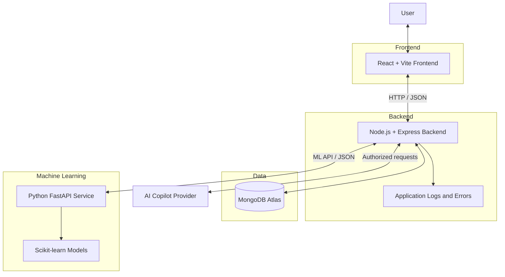
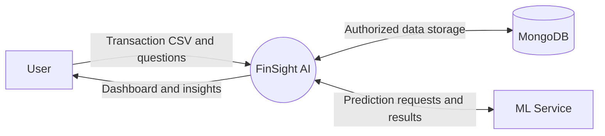
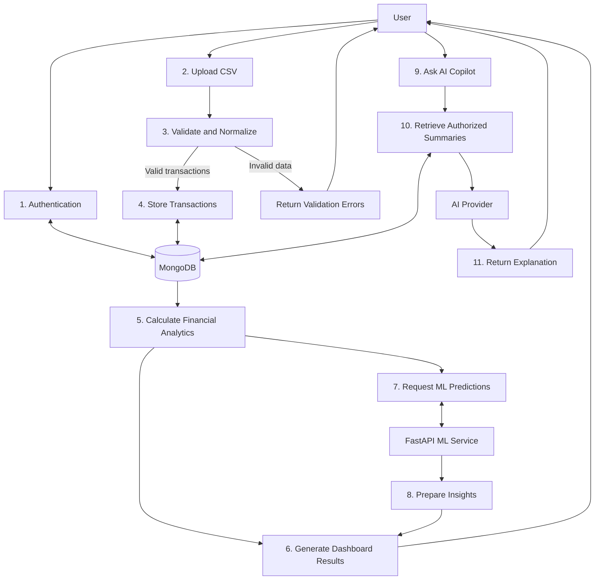
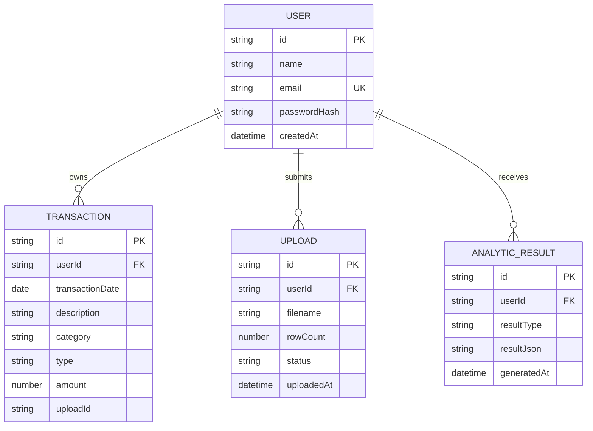

# FinSight AI — System Architecture

## 1. Architecture Overview

## 2. Main Components

| Component | Responsibility |
|---|---|
| React frontend | User interface, forms, dashboard and charts |
| Express backend | API routes, authentication, validation and business logic |
| MongoDB Atlas | Persistent storage for users and transaction records |
| FastAPI service | Machine-learning inference endpoints |
| Scikit-learn | Clustering, anomaly detection and forecasting models |
| AI Copilot provider | Generates explanations using authorized financial summaries |

## 3. Data Flow — Level 0

## 4. Data Flow — Level 1

## 5. Initial Data Model

## 6. Security Principles

- Store password hashes, never plain-text passwords.
- Keep secrets in environment variables.
- Validate uploaded files and all API inputs.
- Restrict every user's records to that authenticated user.
- Do not expose database credentials or AI provider keys to the frontend.
- Use synthetic or anonymized data during development.
- Treat ML predictions and AI explanations as estimates, not guaranteed financial advice.

## 7. Initial Architecture Decisions

- Use REST APIs for frontend-to-backend communication.
- Use JSON for API responses.
- Use MongoDB with Mongoose for data persistence.
- Keep the ML service separate from the Express backend.
- Start with explainable calculations before adding complex ML models.
- Store only the analytics results that need persistence; calculate simple summaries when appropriate.
- Review data retention and privacy requirements before storing sensitive financial records.
